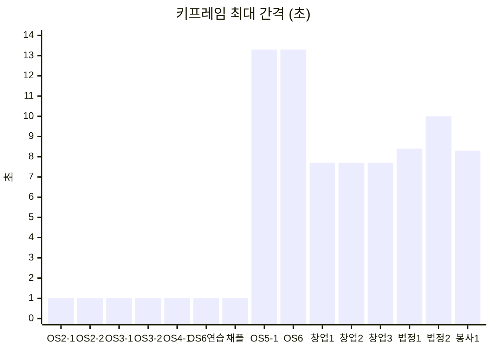
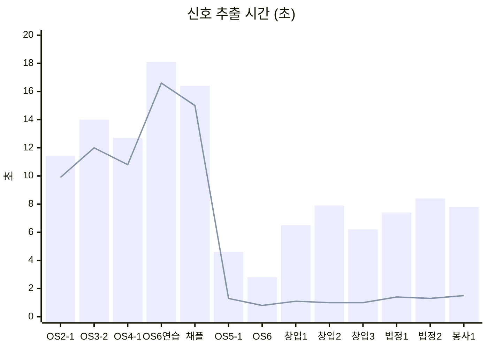
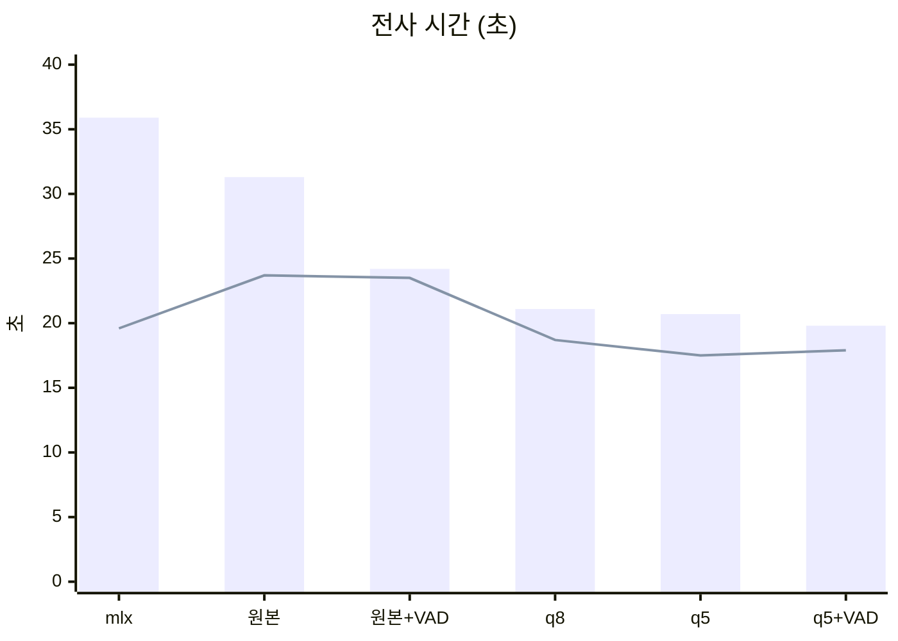
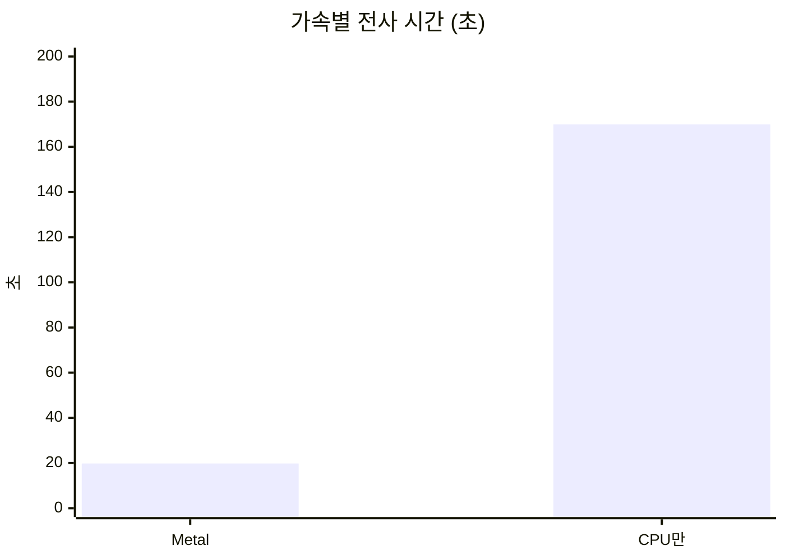
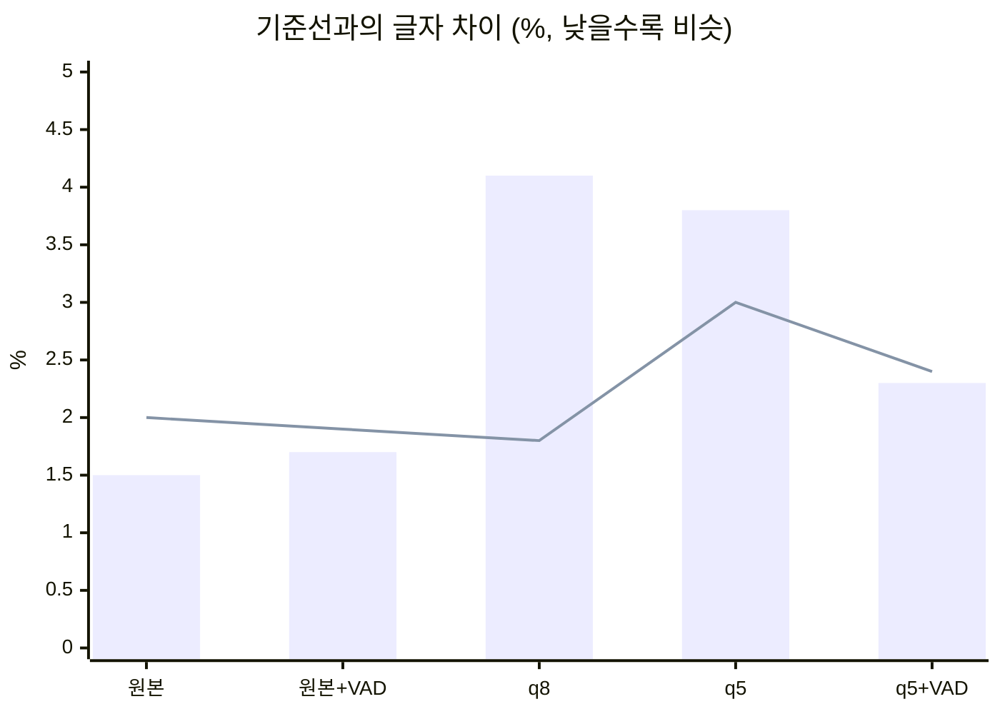

# CanvasDongseo — 강의 동영상 처리 측정 보고서

| 항목 | 내용 |
|---|---|
| 측정일 | 2026-11-08 ~ 2026-11-09 |
| 측정 기기 | MacBook (Apple M5, 메모리 24GB), macOS |
| 대상 기능 | LearningX 수업 동영상 → ① 슬라이드 PDF, ② 강의 스크립트(전사) |
| 목적 | 새 아키텍처(Rust + Tauri)에서 쓸 처리 방식을 측정 결과로 정한다 |

---

## 1. 개요

CanvasDongseo는 학생이 내려받은 강의 동영상에서 **슬라이드를 뽑아 PDF로 만들고**, **음성을 텍스트 스크립트로 바꾸는** 기능을 제공한다. 이 결과물은 요약·퀴즈·예상 시험지를 만드는 근거 자료가 된다.

측정 전(2026-10-26 기준) 쓰던 방식은 다음과 같았다.

| 단계 | 측정 전 방식 |
|---|---|
| 슬라이드 감지 | ffmpeg로 1초에 한 장(폭 320, 회색조)을 뽑아 화면 변화량으로 슬라이드 전환을 찾음 |
| 슬라이드 선택 | 후보를 자동 점수로 정렬한 뒤 **AI 에이전트가 콘택트 시트를 보고 고름** |
| 전사 | `mlx-whisper` (Python, Apple Silicon 전용, 설치 크기 1GB 이상) |

새 버전으로 옮기면서 세 가지를 정해야 했다.

1. 슬라이드 감지를 더 빠르게 할 수 있는가? — **키프레임만 디코딩하는 최적화**의 효과
2. Rust에서 쓸 수 있는 전사 엔진(**whisper.cpp**)이 기준선(**mlx-whisper**)만큼 정확한가?
3. 전사 모델을 얼마나 작게 만들 수 있는가? (설치 용량)

## 2. 측정 대상

LearningX에서 받을 수 있는 영상 중 녹화 방식이 서로 다른 것을 골랐다. 운영체제 기존 영상 3개와 새로 받은 12개를 합쳐 모두 15개다.

| 과목 | 영상 수 | 해상도·프레임 | 녹화 특징 |
|---|---|---|---|
| 운영체제 | 8 | 1080p 15fps / 720p 15fps | everlec 화면 녹화(대부분), 일부 저용량 녹화 |
| AI기반창업마케팅 | 3 | 720p·768p 29.97fps | 타 대학 강사 녹화(부산공유대학) |
| 법정의무교육 | 2 | 720p 30fps / 1080p 29.97fps | 제작 영상 |
| 사회봉사 | 1 | 720p 30fps | 제작 영상 |
| 채플 | 1 | 1080p 15fps | everlec 녹화 |

- 영상은 학교가 허용한 `content_id` 다운로드 경로로만 받았다.
- 측정이 끝난 뒤 영상은 모두 지웠다.

## 3. 측정 ① — 키프레임 디코딩 최적화

### 3.1 무엇을 확인했나

동영상의 프레임은 대부분 "이전 프레임과의 차이"만 담고 있다. 혼자서 완전한 그림인 프레임은 **키프레임**뿐이다. 슬라이드 감지는 1초에 한 장만 보면 되므로, 키프레임 간격이 1초라면 키프레임만 풀어서(`-skip_frame nokey`) 디코딩 시간을 크게 줄일 수 있을 것으로 예상했다.

### 3.2 측정 방법

1. `ffprobe`로 모든 패킷의 시각·크기·키프레임 여부를 읽어 **키프레임 간격**(최대값, 95번째 백분위)과 **키프레임이 차지하는 데이터 비율**을 계산했다.
2. 같은 출력(폭 320, 회색조 raw 프레임)을 만드는 두 방식의 시간을 쟀다.
   - 전부 디코딩: `ffmpeg -i 영상 -vf fps=1,scale=320:-2 ...`
   - 키프레임만: `ffmpeg -skip_frame nokey -i 영상 -vf scale=320:-2 -fps_mode passthrough ...`
3. 운영체제 영상 1개로 하드웨어 디코딩(`-hwaccel videotoolbox`)도 비교했다.
4. 사용 도구는 ffmpeg 9.0.2다.

### 3.3 결과

| 영상 | 키프레임 간격(최대) | 키프레임 데이터 비율 | 전부 디코딩 | 키프레임만 |
|---|---|---|---|---|
| 운영체제 chap2 1차시 (1080p) | 1.0초 | 46% | 11.4초 | 9.9초 |
| 운영체제 chap2 2차시 (1080p) | 1.0초 | — | — | 11.7초 |
| 운영체제 chap3 1차시 (1080p) | 1.0초 | — | — | 10.0초 |
| 운영체제 chap3 2차시 (1080p) | 1.0초 | 48% | 14.0초 | 12.0초 |
| 운영체제 chap4_1 병행 (1080p) | 1.0초 | 48% | 12.7초 | 10.8초 |
| 운영체제 6장 연습문제 (1080p) | 1.0초 | 71% | 18.1초 | 16.6초 |
| 채플 (1080p) | 1.0초 | 61% | 16.4초 | 15.0초 |
| 운영체제 chap5-1 (720p) | **13.3초** | 37% | 4.6초 | 1.3초 |
| 운영체제 6장 (720p) | **13.3초** | 40% | 2.8초 | 0.8초 |
| AI창업 신라대 1차시 | **7.7초** | 7% | 6.5초 | 1.1초 |
| AI창업 신라대 2차시 | **7.7초** | 7% | 7.9초 | 1.0초 |
| AI창업 신라대 3차시 | **7.7초** | 10% | 6.2초 | 1.0초 |
| 법정교육 성희롱 예방 | **8.4초** | 21% | 7.4초 | 1.4초 |
| 법정교육 디지털 성폭력 예방 | **10.0초** | 8% | 8.4초 | 1.3초 |
| 사회봉사 장애인 인식개선 1 | **8.3초** | 11% | 7.8초 | 1.5초 |

하드웨어 디코딩(운영체제 chap2 1차시, 2회 측정): 약 99~105초로, 일반 디코딩(11.4초)보다 **약 9배 느렸다**.

**그래프 1. 영상별 키프레임 최대 간격** (슬라이드 감지는 1초에 한 장이 필요하다)

**그래프 2. 디코딩 시간: 전부 디코딩(막대) 대 키프레임만(선)** (전부 디코딩을 잰 12개 영상)

왼쪽 7개(키프레임 1초)는 막대와 선이 거의 붙어 있다. 오른쪽(키프레임 7.7~13.3초)은 크게 줄지만 그래프 1처럼 전환을 놓친다.

### 3.4 해석

- **키프레임이 1초 간격인 영상(everlec 녹화)에서는 거의 빨라지지 않는다(약 10%).** 화면 녹화는 프레임 사이 변화가 작아서 데이터의 46~71%가 키프레임에 몰려 있다. 키프레임만 풀어도 할 일이 많이 줄지 않는다.
- **키프레임 간격이 긴 영상(7.7~13.3초)에서는 빨라지지만, 슬라이드 전환을 최대 13초 늦게 잡거나 짧게 지나간 슬라이드를 놓친다.** 정확도를 잃는다.
- 전부 디코딩해도 30분 안팎 강의 하나가 **최대 18초**라서, 이미 사용자가 기다리기 어렵지 않은 수준이다.
- 화면 녹화처럼 작은 프레임을 하나씩 내보내는 작업에는 하드웨어 디코딩이 오히려 손해다(GPU와 메모리 사이 복사 비용).

## 4. 측정 ② — 전사 엔진·모델 비교

### 4.1 무엇을 확인했나

앱 코어는 Rust라서 Python 전용인 mlx-whisper를 쓸 수 없다. Rust에서 쓸 수 있는 **whisper.cpp**가 기준선만큼 정확한지, 그리고 모델을 얼마나 작게 줄일 수 있는지를 확인했다.

### 4.2 측정 방법

1. **구간**: 성격이 다른 강의 3개에서 5분 지점부터 10분씩 잘라 16kHz 모노 WAV로 만들었다.
   - 운영체제 chap3 2차시: 전공 용어가 많은 설명형 강의
   - AI창업 신라대 1차시: 다른 강사, 다른 녹음 환경
   - 법정교육 성희롱 예방: 내레이션 위주 제작 영상
2. **기준선**: mlx-whisper 0.4.3, 모델 `whisper-large-v3-turbo`, 한국어, 앞 문맥 미사용(측정 전 설정 그대로).
3. **비교 대상**: whisper.cpp 1.9.5(Metal 가속), 같은 `large-v3-turbo` 모델의 세 가지 형식에 VAD(무음 구간 건너뛰기)를 켠 것과 끈 것.

   | 모델 형식 | 크기 |
   |---|---|
   | 원본(f16) | 1.6GB |
   | q8_0 양자화 | 874MB |
   | q5_0 양자화 | 574MB |
   | Silero VAD v5.1.2 | 0.9MB |

4. **정확도 지표**: 사람이 받아 적은 정답이 없으므로, 공백과 문장부호를 뺀 뒤 **mlx-whisper 결과와의 글자 편집 거리 비율**(낮을수록 기준선과 비슷)을 쟀다. 같은 줄이 3번 이상 반복되는 환각도 셌다. 큰 차이가 난 곳은 직접 읽고 어느 쪽이 맞는지 판단했다.
5. **Windows 근사**: Windows 기기가 없어서 같은 Mac에서 GPU를 끄고(`-ng`) CPU 8스레드로 쟀다.

### 4.3 결과 — 처리 시간 (10분 음성 기준)

| 조합 | 운영체제 | AI창업 | 법정교육 |
|---|---|---|---|
| mlx-whisper (기준선) | 35.9초 | 23.5초 | 19.6초 |
| whisper.cpp 원본, VAD 끔 | 31.3초 | 24.4초 | 23.7초 |
| whisper.cpp 원본, VAD 켬 | 24.2초 | 25.4초 | 23.5초 |
| whisper.cpp q8_0, VAD 끔 | 21.1초 | 20.4초 | 18.7초 |
| whisper.cpp q5_0, VAD 끔 | 20.7초 | 19.2초 | 17.5초 |
| **whisper.cpp q5_0, VAD 켬** | **19.8초** | **20.4초** | **17.9초** |
| whisper.cpp q5_0, VAD 켬, **CPU만** | 169.9초 | — | — |
| whisper.cpp 원본, VAD 켬, **CPU만** | 198.6초 | — | — |

시간에는 모델을 불러오는 시간이 포함된다.

**그래프 3. 전사 시간 — 10분 음성, Apple M5 (막대: 운영체제, 선: 법정교육)**

**그래프 4. GPU(Metal) 대 CPU만 — q5_0 + VAD, 운영체제 10분**

### 4.4 결과 — mlx-whisper와의 글자 차이

| 조합 | 운영체제 | AI창업 | 법정교육 | 반복 환각 |
|---|---|---|---|---|
| 원본, VAD 끔 | 0.8% | 2.0% | 1.5% | 0 |
| 원본, VAD 켬 | 1.3% | 1.9% | 1.7% | 0 |
| q8_0, VAD 끔 | 0.5% | 1.8% | **4.1%** | 0 |
| q5_0, VAD 끔 | 1.3% | 3.0% | **3.8%** | 0 |
| **q5_0, VAD 켬** | **1.7%** | **2.4%** | **2.3%** | 0 |

**그래프 5. mlx-whisper와의 글자 차이 (%) — 막대: 법정교육, 선: AI창업**

법정교육 구간에서 VAD를 끈 양자화 모델(q8, q5)만 튀는 것은 문장 묶음을 통째로 빠뜨렸기 때문이다.

### 4.5 해석

- **품질은 대등하다.** 차이를 직접 읽어 보니 대부분 띄어쓰기("메인 메모리" / "메인메모리")와 문장부호였다. whisper.cpp가 더 정확한 곳도 있었다.

  | mlx-whisper | whisper.cpp | 맞는 것 |
  |---|---|---|
  | 유의시간 | 유휴시간 | whisper.cpp |
  | 중단된 프로세서는 | 중단된 프로세스는 | whisper.cpp |
  | 제어 블락 | 제어 블록 | whisper.cpp |
  | 오퍼레팅 시스템 | 오퍼레이딩 시스템 | 둘 다 틀림 |

- **VAD를 끄면 구간을 통째로 빠뜨리는 일이 생겼다.** 법정교육 구간에서 q8_0·q5_0이 VAD 없이 문장 여러 개를 출력하지 않았다(글자 차이 4.1%, 3.8%). 같은 모델에 VAD를 켜자 2.3%로 돌아왔다. 강의 자료에서 내용이 빠지는 것은 치명적이므로 **VAD는 반드시 켠다.**
- **q5_0은 원본보다 3배 작고 조금 더 빠르며, 정확도 차이는 0.4~0.7%p다.** 차이도 대부분 띄어쓰기 수준이다.
- **Apple Silicon(Metal)에서는 30분 강의를 약 1분에 전사한다.**
- **CPU만 쓰면 10분 음성에 약 170초가 걸린다**(30분 강의 약 8.5분). 일반 Windows 노트북 CPU는 M5보다 느리므로 더 오래 걸릴 것이다. Windows GPU 가속(Vulkan)은 측정하지 못했다.

## 5. 최종 결정

| # | 결정 | 근거 |
|---|---|---|
| D1 | 슬라이드 감지는 **일반 디코딩**(1초에 한 장, 폭 320, 회색조)을 쓴다. 키프레임 최적화와 하드웨어 디코딩은 쓰지 않는다 | §3.4 — 효과가 작거나(10%) 정확도를 잃는다. 하드웨어 디코딩은 9배 느리다 |
| D2 | 슬라이드는 **앱 로직으로 자동 확정**한다. AI 검토 단계를 두지 않는다 | 2026-10-26 실측에서 검토한 13개 묶음 모두 자동 추천이 AI 판단과 같았다. 단계를 줄여 처리 시간을 줄인다 |
| D3 | 학교 서버의 자막은 쓰지 않고 **앱이 직접 전사**한다 | 결과를 신뢰할 수 있는 것은 우리 앱의 처리뿐이다 |
| D4 | 전사는 **whisper.cpp + `large-v3-turbo` q5_0 + Silero VAD**, 한국어, 앞 문맥 미사용 | §4.5 — 품질이 기준선과 대등하고 모델이 574MB. VAD는 내용 누락을 막는다 |
| D5 | 가속은 macOS **Metal**, Windows는 **CPU를 기본**으로 하고 Vulkan은 Windows 개발을 시작할 때 측정한다 | §4.3 |
| D6 | OS별로 나누는 것은 **OCR만**이다(macOS Vision, Windows.Media.Ocr). 디코딩·슬라이드 판정·전사·PDF는 두 OS가 같은 코드를 쓴다 | OS 고유 API가 필요한 것은 OCR뿐이다. Windows 작업량이 OCR 어댑터 하나로 줄어든다 |
| D7 | 부품(ffmpeg 약 6MB, VAD 0.9MB, 전사 모델 574MB)은 **앱 설치 과정에서 자동으로 내려받는다.** 설치 패키지에 모델을 넣지 않는다. 받은 파일은 앱에 고정한 SHA-256으로 확인한다 | 모델 제공 정책상 재배포 문제를 피한다. 사용자는 앱 안에서 따로 설치하지 않는다. 실행 파일(ffmpeg)은 해시와 코드 서명을 함께 확인한다 |

**고정할 해시** (2026-11-09 Hugging Face에서 받은 파일)

| 파일 | SHA-256 |
|---|---|
| `ggml-large-v3-turbo-q5_0.bin` | `394221709cd5ad1f40c46e6031ca61bce88931e6e088c188294c6d5a55ffa7e2` |
| `ggml-silero-v5.1.2.bin` | `29940d98d42b91fbd05ce489f3ecf7c72f0a42f027e4875919a28fb4c04ea2cf` |

## 6. 한계와 남은 측정

- 전사 정확도는 사람이 받아 적은 정답이 아니라 **기존 방식과의 일치도**로 쟀다. 절대 정확도(글자 오류율)는 정답 구간을 만들어 따로 재야 한다.
- 전사 구간은 강의 3개, 10분씩이다. 한 강의 전체(30분 이상)와 더 많은 과목으로 확인하면 좋다.
- Windows 수치는 Mac CPU로 근사한 값이다. 실제 Windows 노트북의 CPU·Vulkan 속도와 한국어 OCR 품질은 Windows 개발을 시작할 때 잰다.
- 슬라이드 감지 기준값(전환 0.2, 같은 슬라이드 0.55)은 운영체제 everlec 영상으로 조정한 값이다. 레이아웃이 다른 영상(AI창업, 제작 영상)으로 다시 확인해야 한다.

## 부록. 재현 방법

1. LearningX `modules?include_detail=true`로 과목별 동영상 `content_id`를 모으고, Commons `content_id` 경로로 받는다([05_commons](../layers/data_access/05_commons.md)).
2. 키프레임: `ffprobe -select_streams v:0 -show_entries packet=pts_time,size,flags -of csv=p=0 <영상>`로 키프레임 시각·크기를 읽는다.
3. 디코딩 시간: §3.2의 두 `ffmpeg` 명령을 `-f rawvideo -pix_fmt gray -` 출력으로 실행해 경과 시간을 잰다.
4. 전사: `ffmpeg -ss 300 -t 600 -i <영상> -vn -ac 1 -ar 16000 -c:a pcm_s16le <구간>.wav` 뒤 `whisper-cli -m <모델> -l ko -mc 0 -t 8 [--vad --vad-model <VAD 모델>] -f <구간>.wav -otxt`.
5. 비교: 공백·문장부호를 뺀 두 결과의 글자 편집 거리 ÷ 기준선 글자 수.
